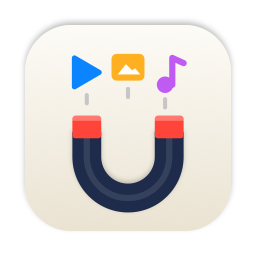
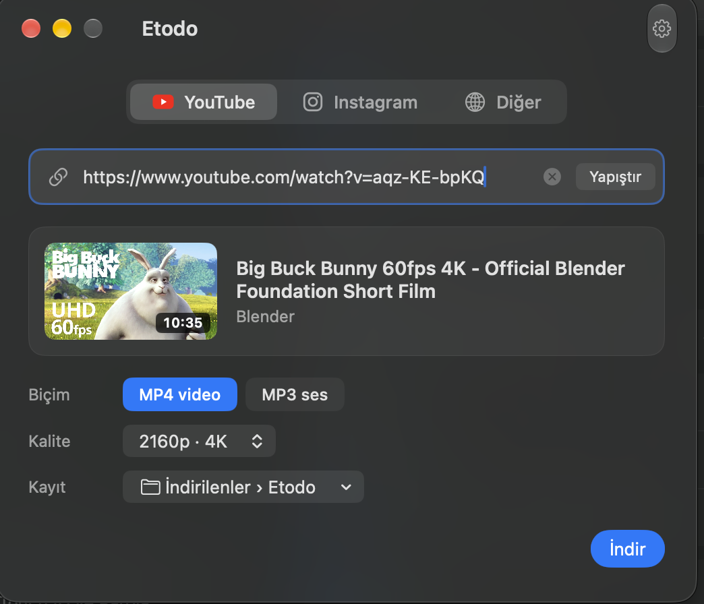
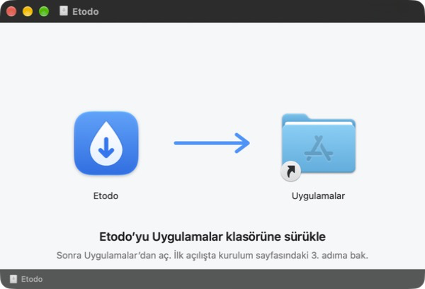
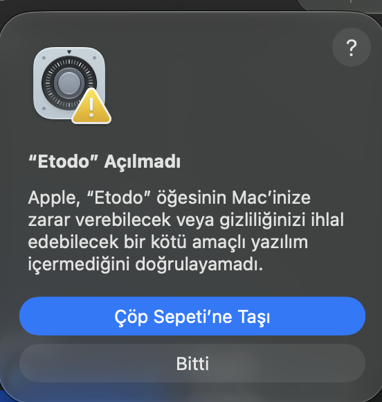
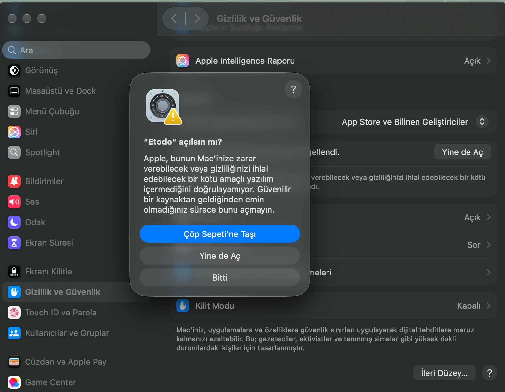

<p align="center">
  
</p>

<h1 align="center">Etodo</h1>
<p align="center"><b>Everything to Download</b><br>YouTube, Instagram, X (Twitter) ve daha fazlasından video, ses ve fotoğraf indiren sade bir Mac uygulaması.</p>

<p align="center">
  <a href="https://github.com/Melbergmbk/etodo/releases/latest/download/Etodo.dmg"><b>⬇︎ Etodo'yu indir</b></a>
  &nbsp;·&nbsp; macOS 14 ve üzeri &nbsp;·&nbsp; Ücretsiz
</p>

<p align="center"></p>

---

## Kurulum

Toplam 2 dakika sürer. Yalnızca ilk seferde 3. adımdaki onay gerekir.

### 1. İndir
Yukarıdaki **Etodo'yu indir** bağlantısına tıkla. `Etodo.dmg` adlı dosya İndirilenler klasörüne iner.

### 2. Uygulamalar klasörüne sürükle
İndirilen dosyayı çift tıklayarak aç. Açılan pencerede **Etodo** simgesini yanındaki **Uygulamalar** klasörüne sürükle.

<p align="center"></p>

### 3. İlk açılışta bir kez izin ver
Etodo'yu Uygulamalar klasöründen açmaya çalıştığında Mac şu uyarıyı gösterir. **Bitti**'ye bas.

<p align="center"></p>

> **Bu uyarı neden çıkıyor?** Etodo, Apple'ın ücretli geliştirici programına kayıtlı değil. Mac kayıtlı olmayan her uygulamada bir kez sorar. Etodo'nun bütün kodu bu sayfada açık; uygulama bilgilerini hiçbir yere göndermez.

Sonra:

1. Ekranın sol üstündeki  menüsünden **Sistem Ayarları**'nı aç.
2. Soldan **Gizlilik ve Güvenlik**'e tıkla.
3. Sayfayı aşağı kaydır. Etodo'nun engellendiğini söyleyen satırın yanındaki **Yine de Aç** düğmesine bas.
4. *"Etodo açılsın mı?"* penceresi çıkar. Buradaki **Yine de Aç**'a bas. Mac parolanı ya da Touch ID'ni sorarsa gir.

<p align="center"></p>

Hepsi bu. Bundan sonra Etodo her zaman normal bir uygulama gibi açılır.

### 4. İlk açılış
- Kısa bir kullanım uyarısı çıkar. Okuyup **Anladım**'a bas.
- Etodo, indirme için gereken araçları kendisi kurar (bir defalık, internet hızına göre 1–3 dakika). Bu sırada uygulamayı kapatma.

---

## Kullanım

1. Üstten siteyi seç: **YouTube**, **Instagram** ya da **Diğer** (X, TikTok ve yüzlerce site).
2. Linki yapıştır (**⌘V**). Etodo videonun ön izlemesini gösterir.
3. **MP4** (video) ya da **MP3** (ses) seç, kaliteyi belirle — her seçeneğin yanında dosyanın yaklaşık boyutu yazar — ve **İndir**'e bas. Etodo son seçimini hatırlar.
4. İndirme sürerken bir sonraki linki yapıştırıp **Sıraya ekle**'ye basabilirsin; sırayla iner.

Pencerenin altındaki **İndirmeler** listesinde süren, sıradaki ve biten indirmeler görünür. Bitenlerin yanında **Göster** (Finder'da açar) ve **Tekrar indir** vardır. Liste son 20 indirmeyi yalnız bu Mac'te tutar; **Bitenleri temizle** ile silinir. Uzun bir indirme bitince Mac bildirimi gelir.

YouTube videolarında **Türkçe ya da İngilizce altyazı ekle** kutusunu işaretlersen, varsa altyazı videonun içine eklenir (QuickTime'da Görüntü › Altyazılar).

Dosyalar kendiliğinden düzenli klasörlere iner:

```
İndirilenler/Etodo/
├─ YouTube/<kanal adı>/Videolar · Shorts · Sesler
├─ Instagram/@kullanıcı/Reels · Gönderiler · Hikâyeler
├─ X (Twitter)/@kullanıcı/Gönderiler
├─ TikTok/@kullanıcı/Videolar
└─ Diğer/<site adı>/…
```

Kayıt yerini indirme butonunun üstündeki klasör menüsünden değiştirebilirsin.

---

## Instagram için ek adım

Instagram, giriş yapmadan çoğu içeriği vermez. Etodo bu durumda bilgisayarındaki tarayıcıda (ör. Chrome) açık olan Instagram oturumunu kullanır. Bunun için:

1. Tarayıcında Instagram hesabına giriş yapmış ol.
2. Etodo'nun Ayarlar › Genel bölümünde o tarayıcıyı seç.
3. **Chrome, Brave ya da Edge** kullanıyorsan macOS ilk seferde bir kez Mac'inin giriş şifresini sorar; şifreyi yazıp **Her Zaman İzin Ver**'i seç.
4. **Safari** kullanıyorsan Etodo bir kez **Tam Disk Erişimi** ister. Hata kutusundaki adımları izle: **Ayarları Aç** → listede Etodo yoksa alttaki **+** ile ekle → anahtarı aç → Etodo'yu kapatıp yeniden aç.

Arc ya da Opera desteklenmiyor; bunları kullanıyorsan Instagram'a bir kez Chrome, Safari ya da Firefox'ta giriş yap.

Çerezlerin bilgisayarından hiçbir yere gönderilmez. Yalnızca indirme sırasında, senin Mac'inde kullanılır.

---

## Güncellemeler

Etodo hem kendisini hem indirme araçlarını güncel tutar. Yeni sürüm çıkınca bir pencere açılır ve pencerenin sağ üstünde küçük bir **Yeni sürüm** rozeti belirir. Beklemeden bakmak için menüden **Etodo › Güncellemeleri Kontrol Et…**

---

## Sık sorulanlar

**4K YouTube videosu QuickTime'da açılmıyor.**
YouTube 4K videoları Apple'ın QuickTime'ının açamadığı bir biçimde yayınlar. [IINA](https://iina.io) ya da [VLC](https://www.videolan.org) ile sorunsuz açılır. Ya da kaliteyi 1080p seç.

**"Bu gönderi görünmüyor" diyor.**
Hesap gizli olabilir ya da gönderi silinmiş olabilir. Gizli hesaplarda, tarayıcında o hesabı görebilen kullanıcıyla giriş yapmış olman gerekir.

**Uygulamayı nasıl kaldırırım?**
Uygulamalar klasöründeki Etodo'yu Çöp Sepeti'ne at. Araçları da silmek istersen Finder'da **Git › Klasöre Git** ile `~/Library/Application Support/Etodo` klasörünü açıp sil. İstersen `~/Library/Caches/pip` ve `~/Library/Caches/yt-dlp` klasörlerini de silebilirsin. İndirdiğin dosyalara dokunulmaz.

**Bir hata aldım.**
Hata kutusundaki **Ayrıntıları göster › Kopyala** ile metni kopyalayıp bana ilet.

---

## Kullanmadan önce

Etodo yalnızca kişisel ve ticari olmayan kullanım içindir. İndirdiğin içeriklerin hakları, onları üretenlere aittir. İçerikleri yalnızca hak sahibinin izin verdiği ya da kanunun kişisel kullanıma imkân tanıdığı ölçüde kullan; başkalarıyla paylaşmak, yeniden yayımlamak veya ticari amaçla kullanmak senin sorumluluğundadır. İndirme yaptığın platformların kullanım koşullarına uymak da sana aittir.

## Lisans ve kullanılan araçlar

Etodo'nun kendi kodu [MIT lisansıyla](LICENSE) açıktır: adı korunduğu sürece herkes kullanabilir, değiştirebilir ve paylaşabilir; yazılım "olduğu gibi" sunulur.

Etodo aşağıdaki ücretsiz, açık kaynaklı yazılımları kullanır; her biri kendi lisansına tabidir. Sparkle uygulamanın içinde gelir ([lisans metni](App/Resources/Sparkle-LICENSE.txt)). Diğerleri kurulum dosyasında yer almaz; ilk açılışta kendi kaynaklarından senin Mac'ine indirilir ve sağlama toplamı ya da çalışma testiyle doğrulanır.

| Yazılım | Ne için | Lisans |
|---|---|---|
| [yt-dlp](https://github.com/yt-dlp/yt-dlp) | Video ve ses indirme | Unlicense |
| [gallery-dl](https://github.com/mikf/gallery-dl) | Fotoğraf ve galeri indirme | GPL-2.0 |
| [FFmpeg](https://ffmpeg.org) | Görüntü ve sesi birleştirme, dönüştürme | GPL |
| [Deno](https://deno.com) | YouTube bağlantılarını çözme | MIT |
| [Python](https://www.python.org) | yt-dlp ve gallery-dl'nin çalışma ortamı | PSF |
| [Sparkle](https://sparkle-project.org) | Uygulama güncellemeleri (uygulamanın içinde) | MIT |

---

<p align="center"><sub><b>MBK</b> · Melih Buğra Karaşın tarafından geliştirildi</sub></p>
